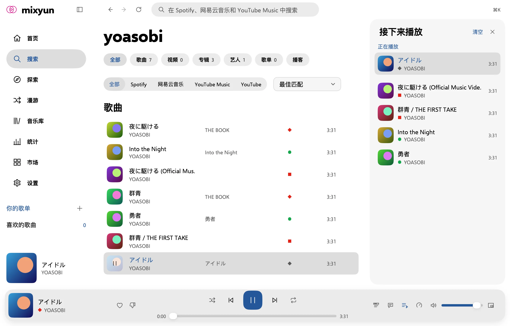
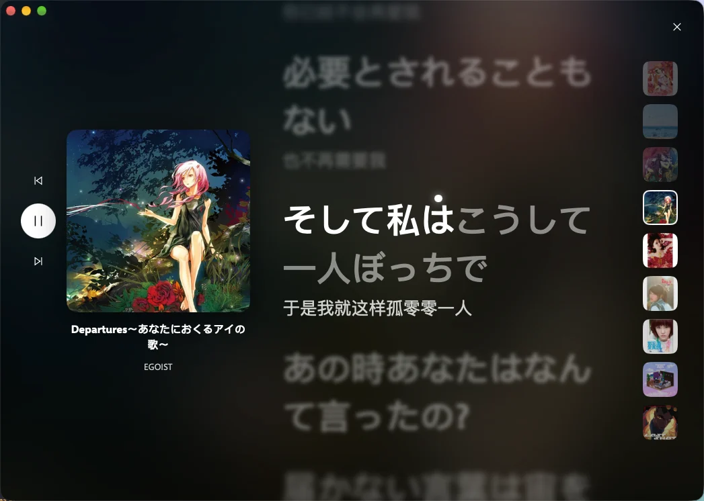
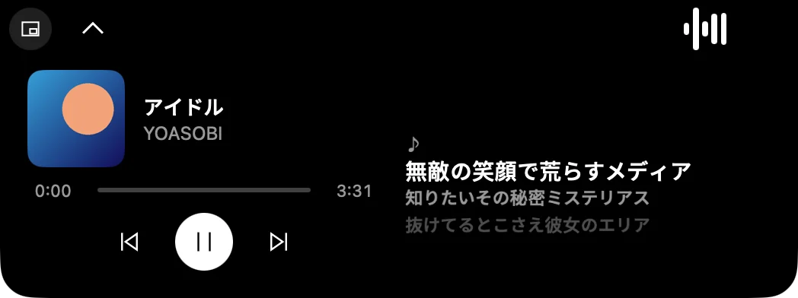

<p align="center"><strong>简体中文</strong> · <a href="README.en.md">English</a></p>

<p align="center">
  
</p>

<h1 align="center">混云 Mixyun</h1>

<p align="center"><strong>网易云音乐、YouTube Music 和 Spotify，放进同一个播放器。</strong></p>

<p align="center">适用于 macOS、Windows 和 Linux 的桌面音乐播放器：中文界面，逐字歌词，无损音质，悬浮歌词、刘海歌词和任务栏歌词。</p>

<p align="center">
  <a href="https://github.com/Shizuku11451/mixyun/releases/latest"></a>
  <a href="https://github.com/Shizuku11451/mixyun/actions/workflows/ci.yml"></a>
  
  <a href="#许可证"></a>
</p>

<p align="center">
  <a href="https://github.com/Shizuku11451/mixyun/releases/latest">下载</a> ·
  <a href="CHANGELOG.md">更新日志</a> ·
  <a href="https://github.com/Shizuku11451/mixyun/issues">反馈问题</a>
</p>

<p align="center">
  
</p>

> 混云是 [MixMusic](https://github.com/fzn0x/mixmusic) 的分支。MixMusic 把 YouTube Music 和 Spotify 放在一起；混云保留了它的全部功能，加上了网易云音乐、简体中文界面，以及更多面向中文用户的歌词功能。感谢 MixMusic 的作者和贡献者。

## 功能

### 三个服务，一个播放器

- **一个搜索框搜三边**：网易云音乐排在前面，YouTube Music 和 Spotify 的结果跟在后面，每条都标着来自哪个服务；边打字边给出歌曲、歌手、专辑和歌单的联想。
- **一个播放队列，混合歌单**：不同服务的歌可以排进同一个队列、存进同一个歌单（混合歌单），也可以把某个服务的歌单导入进来。
- **网易云音乐**：登录后用自己的歌单和喜欢的音乐；按标签漫游，或按你喜欢的歌漫游（心动模式），队列播完自动续上。音质可选，最高无损 FLAC（需要账号有相应权限）。
- **YouTube Music**：不登录也能播放；登录后有首页推荐、喜欢的歌曲和播放记录，还有播客。SponsorBlock 标出的片段可以自动跳过。
- **Spotify**：在混云里直接播放（需要 Premium，Windows 和 macOS），通过 Spotify Connect 控制手机或音箱，或者用 YouTube Music 上的同一首录音来播放，不需要 Premium。
- **下载和本地音乐**：网易云音乐的歌按原格式（MP3 或 FLAC）下载，离线也能听；也能播放电脑里的 MP3、FLAC、WAV、M4A、Opus 和 Vorbis 文件。

### 歌词

- **逐字歌词**：有逐字时间轴的歌，一个字一个字地亮起来。歌词来源可以自己选择和排序：网易云音乐、LRCLIB、YouTube 字幕等。
- **歌词翻译**：优先用网易云音乐里听众写的中文翻译；没有时用机器翻译，可以选 Unison，也可以接入任意兼容 OpenAI 接口的大模型服务（内置十一个服务商预设）。
- **日文罗马音**：日文歌词可以在每行下面显示罗马音。
- **全屏歌词**：歌词铺满窗口，背景是模糊的封面，右侧一列封面显示队列里正在播放的那首。
- **悬浮歌词窗口**：浮在其他应用上面唱当前这一句，长句会随演唱滚动，可以锁定位置；在 macOS 上是 Liquid Glass 玻璃效果。
- **刘海歌词**（macOS）：在屏幕刘海周围显示歌词和播放器，换行时平滑滚动。
- **任务栏歌词**（Windows）：在任务栏上逐字显示歌词和翻译，点封面展开一个小播放器。
- **菜单栏歌词**（macOS）：在菜单栏显示正在唱的那一句。

### 声音

- 淡入淡出、响度均衡，十段均衡器和预设。
- 正在播放页显示当前音质，还有可视化效果。
- 投屏到 Chromecast 等设备，选择输出设备。

### 和朋友一起听

- **房间**：开一个房间，朋友用房间码或邀请链接加入，同一个局域网或者通过互联网都可以；房主可以让访客点歌、控制播放，或者把房主交给别人。
- **Last.fm 和 ListenBrainz**：记录听过的歌，离线时的记录联网后补发，喜欢的歌可以同步为"喜爱"。
- **Discord 状态**：在 Discord 个人资料上显示正在听的歌。

### 按你的习惯来

- **布局和主题**：四种布局、十几套主题，深色和浅色各选一套，强调色可以取自正在播放的封面；支持社区主题和插件。
- **键盘优先**：所有命令都能设置快捷键，全局快捷键在别的应用前台时也能用，还有命令面板（<kbd>Ctrl</kbd> <kbd>K</kbd>）。
- **迷你播放器**：小窗口置顶，可以展开队列。
- **统计**：播放热力图、年度回顾、常听的语言和曲风，以及每个服务各播了多少首。
- **远程控制和 AI 助手**：在局域网里用另一台设备控制播放；支持 MCP 协议的 AI 助手可以查询和控制播放。
- **中文界面**：界面完整翻译成简体中文，设置按主题分区排列。

## 截图

<table>
  <tr>
    <td></td>
    <td></td>
  </tr>
  <tr>
    <td align="center"><sub>一个搜索框搜三个服务</sub></td>
    <td align="center"><sub>全屏歌词</sub></td>
  </tr>
  <tr>
    <td></td>
    <td></td>
  </tr>
  <tr>
    <td align="center"><sub>悬浮歌词窗口</sub></td>
    <td align="center"><sub>刘海歌词（macOS）</sub></td>
  </tr>
  <tr>
    <td colspan="2"></td>
  </tr>
  <tr>
    <td colspan="2" align="center"><sub>任务栏歌词（Windows）</sub></td>
  </tr>
</table>

## 安装

到 [Releases 页面](https://github.com/Shizuku11451/mixyun/releases/latest) 下载对应系统的安装包：

| 系统 | 文件 |
| --- | --- |
| macOS 12 及以上（Apple 芯片和 Intel） | `mixmusic-版本号-macos-universal.dmg` |
| Windows 10 / 11（x64 和 ARM64） | `mixmusic-版本号-windows-架构-setup.exe`，或免安装的 `-portable.zip` |
| Debian / Ubuntu | `.deb` |
| Fedora / openSUSE | `.rpm` |
| 任意 Linux（x64 和 ARM64） | `.AppImage`、`.flatpak` 或 `.tar.gz` |

> 安装包文件名暂时沿用 `mixmusic-` 开头，装好后应用名就是混云（Mixyun）。

**macOS 首次打开**：应用还没有经过 Apple 公证，第一次需要在 系统设置 › 隐私与安全性 里点"仍要打开"，或者在终端运行：

```sh
xattr -dr com.apple.quarantine /Applications/Mixyun.app
```

**Windows 首次打开**：安装包还没有签名，如果 SmartScreen 弹出警告，点"更多信息" › "仍要运行"。

装好后应用会自动检查并安装更新。

## 账号（都是可选的）

在 设置 › 账号 登录：

- **网易云音乐**：自己的歌单、喜欢的音乐和心动模式；VIP 账号可以播放更高音质。
- **YouTube Music**：在 Google 自己的页面登录，用自己的首页、喜欢的歌曲、歌单和播放记录。不登录也能搜索和播放。
- **Spotify**：自己的音乐库；在混云里直接播放需要 Premium。
- **Last.fm、ListenBrainz**：记录听歌。

## 从源码构建

需要 [Go](https://go.dev/dl/) 1.27.3 或更高版本、[Bun](https://bun.sh) 1.2 或更高版本，以及 Git：

```sh
git clone https://github.com/Shizuku11451/mixyun
cd mixyun
bun install
bun run dev     # 开发模式运行
bun run build   # 构建安装包，输出到 build/
```

Linux 还需要 GTK、PulseAudio、WebKitGTK 等运行库，详见[英文 README](README.en.md#linux)。

## 隐私

混云没有自己的账号体系和服务器，也不做统计和遥测。登录信息保存在系统钥匙串里，只发给对应的音乐服务。歌词翻译选了大模型时，歌词会发给你填写的服务；API 密钥只通过 HTTPS 发送（本机地址除外）。

## 许可证

可任选 [MIT](LICENSE-MIT) 或 [GPL-3.0](LICENSE-GPL) 使用，与原项目 MixMusic 相同。
